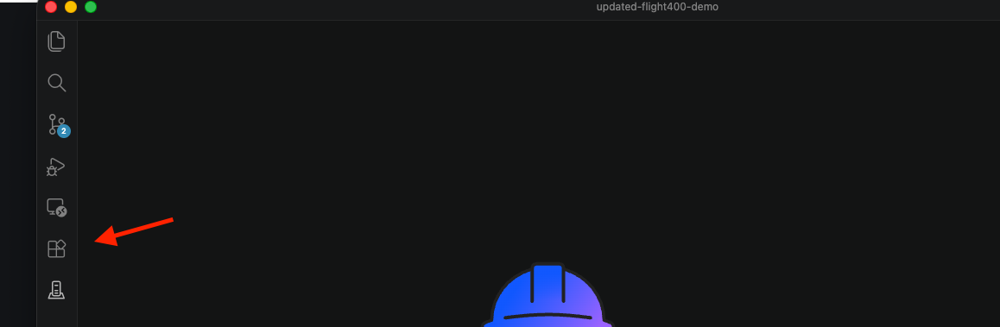
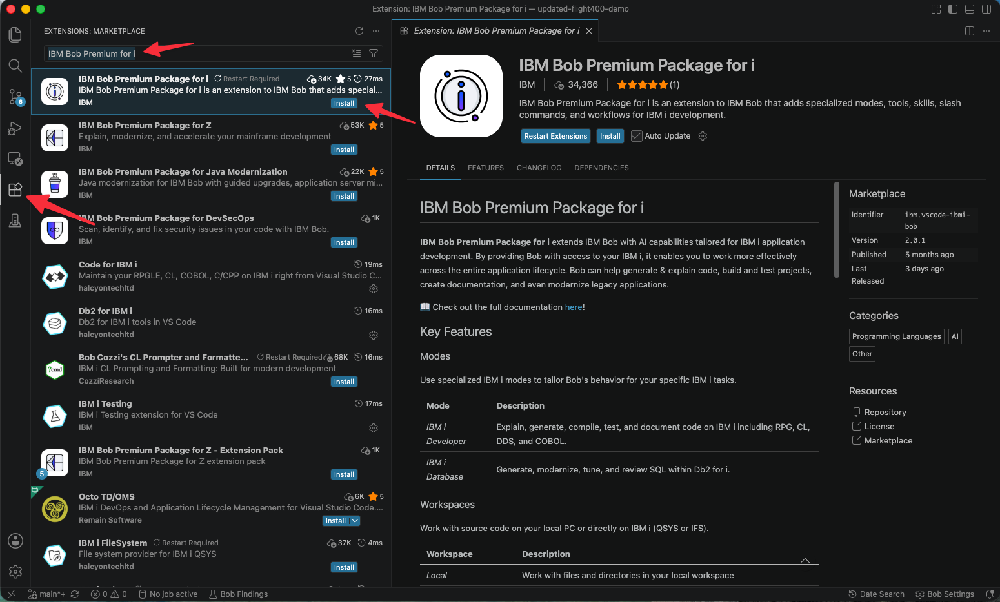
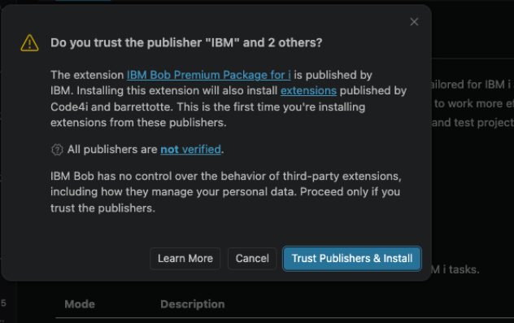
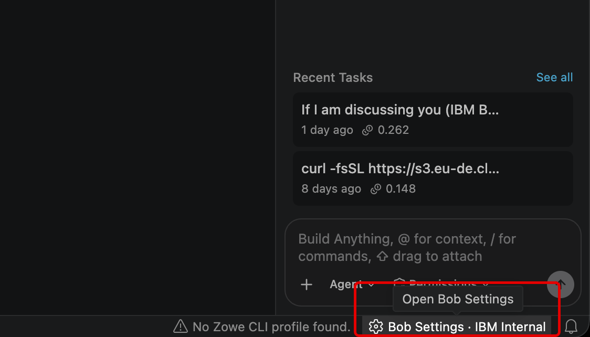
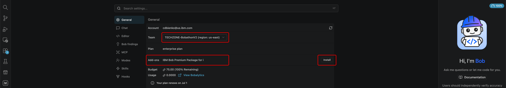
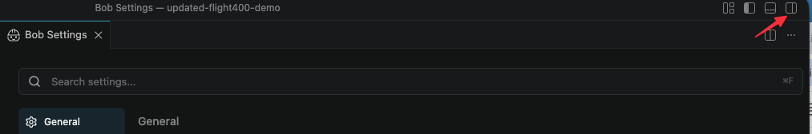
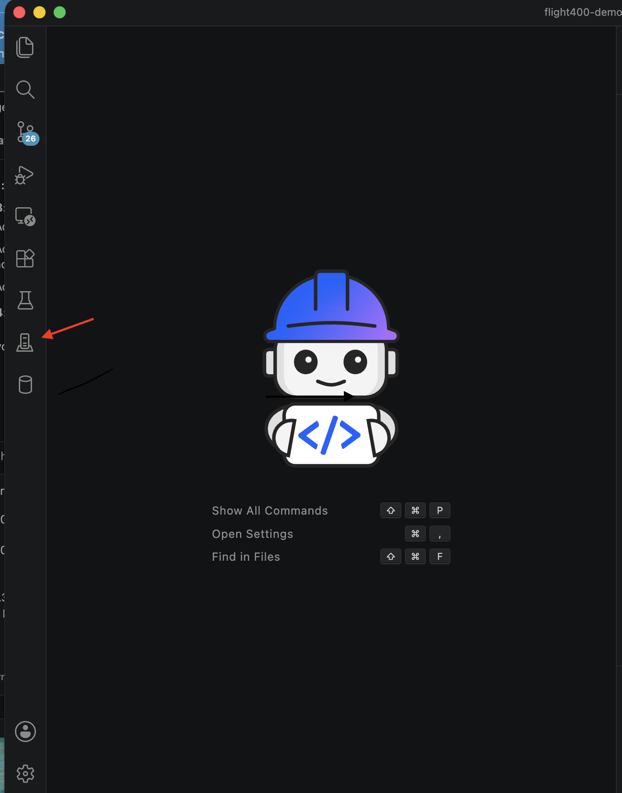
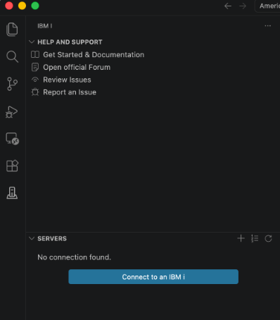
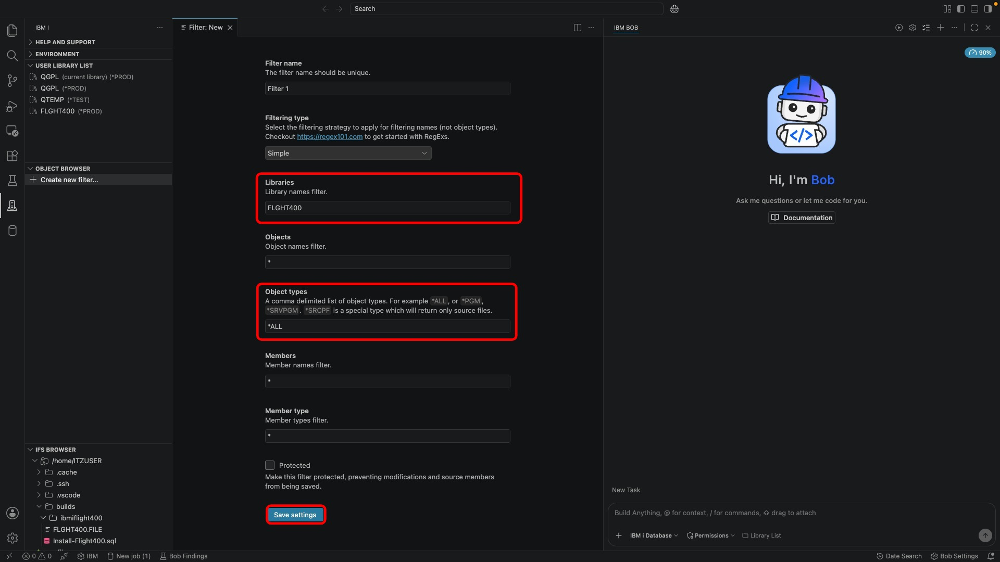
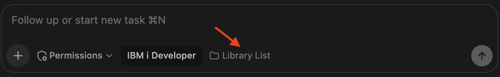

<!-- Generated from docs/tracks/setup.html by build-setup-md.py. Do not edit by hand. -->

# Environment Setup

Complete all steps below before starting any lab. Start by installing and logging in to Bob, then verify your extensions, find your library number, and finally connect to IBM i.

---

## 0.1 — Prerequisite Bob Setup

Check your inbox for the **"You've been invited to join your team"** email, then follow these steps to install Bob and sign in for the first time. If you did not receive an email, please reach out to your manager or IBM representative.

1. **Create your IBM ID** — Open the invitation email and click the link to create your IBM ID. This gives you an account to access IBM Bob.

2. **Download & open Bob** — Download Bob using the correct installer for your computer, then open it. If Bob asks whether to import settings from another editor, select your regular IDE or click **Skip for now**. If it asks about chat migration, click **Skip migration**.

3. **Log in to Bob** — In the Bob chat window, click **Log in to Bob**. When asked to allow Bob to sign in, click **Allow**. Bob will then ask if you want to open a link — click **Open**. This opens your browser to complete the sign-in.

4. **Verify your account is active** — Click the **gear icon** above the Bob chat window. If the chat window isn't open, click the Bob icon to the right of the center search bar to open it first.

   

   *Open Bob settings with the gear icon above the chat window*

   Under the **General** tab, confirm that coins are listed in your budget at **100% remaining** — this means your account is active and ready. You're all set even if you don't see a team name matching the screenshot below.

   > 💡 **Team dropdown:** If you have used Bob before and belong to multiple teams, a team dropdown will appear — make sure it shows a team with **Bobathon** in the name. If you only belong to one team, the dropdown may not be visible at all, which is expected.

   

   *If a team dropdown appears, select the Bobathon team*

---

## 0.2 — Verify and Install Required Extensions

In this step, you will be installing two extensions required for the Bob for i Lab. The **IBM Bob Premium Package for i** is often pre-installed for your team, so verify it below. The **IBM i Development Pack** must be installed manually.

1. **Open the Extensions view** — Click the Extensions icon in the Activity Bar — the vertical strip of icons on the far left side of Bob — or press `Cmd+Shift+X` (macOS) or `Ctrl+Shift+X` (Windows/Linux) to open the Extensions panel.

   

   *Click the Extensions icon in the Activity Bar to open the Extensions panel*

2. **Verify IBM Bob Premium Package for i** — Search for **"IBM Bob Premium Package for i"**. If **IBM Bob Premium Package for i** (publisher: IBM) appears with an **Install** button on the right, click **Install** now. A prompt will ask whether you trust the publishers. Click **Trust Publishers & Install** to continue. If there is no **Install** button, you're all set — skip to step 3. This package includes Code for IBM i (source editing, object browser, IFS browser, Db2 for i, and more).

   > 💡 **What is IBM Bob Premium Package for i?** IBM Bob is an AI coding assistant, a lot like having a smart helper sitting next to you while you code. By default, Bob only works on files on your PC. The Premium Package for i is the add-on that connects Bob directly to your IBM i. Bob can then read, explain, edit, and test your RPG, CL, and SQL right where it lives. You don’t export it, edit it, and copy it back. It also comes with the Code for IBM i tools you already know.

   

   *Search for "IBM Bob Premium Package for i" — an Install button on the right means it still needs to be installed*

   

   *Click Trust Publishers & Install when prompted*

3. **Install IBM i Development Pack** — Now you are installing the second extension. Use the search bar again to find **"IBM i Development Pack"**. Click the blue **Install** button. Reload Bob if prompted.

   > 💡 **What is the IBM i Development Pack?** The IBM i Development Pack adds all the IBM i tools to Bob in one install, so Bob can use them. That includes the connection to your system and the editing and database tools for RPG, CL, COBOL, and SQL. Think of it as the toolbox, and Bob is the AI helper that uses it.

4. **Open Bob Settings** — Next, in the bottom right corner of the screen, click **Open Bob Settings**.

   

   *Click Bob Settings in the bottom-right corner of the Bob IDE*

5. **Install Premium Package for i** — Further down the panel, next to the **Add ons** setting, you should see "IBM Bob Premium Package for i" displayed. Click **Install**. This is a required activation within Settings to fully connect the Premium Package. After it's done downloading, Bob may ask you to restart. If so, accept and re-open the Bob app.

   > ⚠️ If you do not see the add-on, please contact your manager or IBM representative. This means you likely do not have access to the environment. Also make sure you are in the right team.

   

   *Click Install next to IBM Bob Premium Package for i under Add ons*

6. **Confirm it is activated in Bob** — Finally, click the icon in the very top right corner (shown in the first screenshot below). This will open the Bob chat interface on the right-hand side. Using this interface is how you will interact with Bob. Then click **Agent** or the **+** sign, and you should see the **IBM i Developer** and **IBM i Database** modes listed as options. If they do not appear, your IBM Bob account likely has not been linked to your Premium Package for i entitlements yet. If you do not see both modes, reach out to your manager or IBM representative.

   

   *Click the icon in the top-right corner to return to the Bob chat*

   

   *IBM i Developer and IBM i Database appear in the mode list*

7. **Understanding Bob Modes**

   > **Note:** This step is only to help you learn about Bob modes. Nothing on your end needs to be completed.

   Bob comes with 3 modes, and the Premium Package for i adds 2 more. In total, you will have 5 modes that Bob can use.

   A mode is like a job description for Bob. It tells Bob two things: how to act (its role and expertise), and what it is allowed to touch (its permissions). Switching modes is like giving the same assistant a different job.

   **Bob comes with 3 default modes:**

   **1) Agent Mode**

   > **Role (the doer):** Turns an idea or plan into working code. Use it to write, change, or refactor code, implement features, and fix bugs. **Permissions:** Broadest. It can read, edit, and run commands.

   **2) Plan Mode**

   > **Role (the architect):** Analyzes requirements and designs the steps before any code is written. **Permissions:** It can read, but it can only edit Markdown and text files — **meaning it cannot edit any coding files**. It can write a plan, but it cannot change your code.

   **3) Ask Mode**

   > **Role (the explainer):** Answers questions and explains code without making changes. **Permissions:** Read only.

   > 💡 **Tip:** Want to understand code? Use **Ask**. Want a plan first? Use **Plan**. Ready to build? Switch to **Agent**.

   **IBM i specific modes:** The IBM Bob Premium Package for i adds two IBM i specialist modes. They already know IBM i terms and best practices, so you don't have to explain the platform to Bob. At the start of each task, Bob automatically receives your connection details, OS version, CCSID settings, and library lists.

   **1) IBM i Developer Mode**

   > **Role (the IBM i programmer):** Explains, generates, compiles, tests, and documents code on IBM i. It works with RPG (OPM and ILE), SQL on Db2 for i, CL, DDS, and COBOL. **Typical tasks:** Explain or document program logic, write or refactor source code, compile objects, generate and fix RPG unit tests, plan modernization, convert fixed-format RPG to free-format. **Permissions:** Read, edit, execute, MCP, todo, subtask, and skill.

   **2) IBM i Database Mode**

   > **Role (the Db2 for i specialist):** Generates, modernizes, tunes, and reviews SQL on Db2 for i. It checks for correctness, performance, security, and IBM i best practices. It also helps you understand complex database schemas and analyze query performance and indexes. **Permissions:** The same as IBM i Developer, except it does not include MCP.

   > 💡 **Tip:** Use **IBM i Developer** for code work. Use **IBM i Database** for SQL and schema work.

---

## 0.3 — Choose Your Server, IP Address and Library Number

Now we will connect to the TechZone Application by choosing your server, IP address, and library number.

1. **Locate your assigned IP address and library number** — Your instructor will share the server IP address with you and display a spreadsheet assigning each participant a library number. Each participant has their own copy of the FLIGHT400 application in an isolated library named **FLGHT4nn** (e.g. FLGHT401, FLGHT402). Use only your assigned number throughout the lab so everyone can work independently without overwriting each other.

   > 💡 **Spelling note:** The library name is `FLGHT4nn` — note there is **no "I"** in FLGHT. Your instructor may say "Flight 4-nn" verbally, but when typing always use `FLGHT4nn` (F‑L‑G‑H‑T).

2. **Type in the IP address from your instructor** — Type the IP address provided by your instructor into the box below. You only do this once — all connection settings and prompts across this guide will update to match.

   Your instructor will give you the IP address of your server. Wherever this guide shows `<myIPaddress>`, use that address.

3. **Select your assigned library number** — Find your assigned Student # in the table below and click the **Select** button. A quick confirmation pop-up will appear to verify your choice. Once confirmed, all commands, library names, dev ports, and prompts throughout the guide will automatically update to match your number.

   | Student # | Select | Library | Dev Port | React App URL |
   |:---:|:---:|---|:---:|---|
   | 1 |  | `FLGHT401` | 3001 | `http://localhost:3001` |
   | 2 |  | `FLGHT402` | 3002 | `http://localhost:3002` |
   | 3 |  | `FLGHT403` | 3003 | `http://localhost:3003` |
   | 4 |  | `FLGHT404` | 3004 | `http://localhost:3004` |
   | 5 |  | `FLGHT405` | 3005 | `http://localhost:3005` |
   | 6 |  | `FLGHT406` | 3006 | `http://localhost:3006` |
   | 7 |  | `FLGHT407` | 3007 | `http://localhost:3007` |
   | 8 |  | `FLGHT408` | 3008 | `http://localhost:3008` |
   | 9 |  | `FLGHT409` | 3009 | `http://localhost:3009` |
   | 10 |  | `FLGHT410` | 3010 | `http://localhost:3010` |
   | 11 |  | `FLGHT411` | 3011 | `http://localhost:3011` |
   | 12 |  | `FLGHT412` | 3012 | `http://localhost:3012` |
   | 13 |  | `FLGHT413` | 3013 | `http://localhost:3013` |
   | 14 |  | `FLGHT414` | 3014 | `http://localhost:3014` |
   | 15 |  | `FLGHT415` | 3015 | `http://localhost:3015` |
   | 16 |  | `FLGHT416` | 3016 | `http://localhost:3016` |
   | 17 |  | `FLGHT417` | 3017 | `http://localhost:3017` |
   | 18 |  | `FLGHT418` | 3018 | `http://localhost:3018` |
   | 19 |  | `FLGHT419` | 3019 | `http://localhost:3019` |
   | 20 |  | `FLGHT420` | 3020 | `http://localhost:3020` |

   > 💡 **Note:** The **Dev Port** (`30nn`) is only used later in **Lab 4** when launching the modernized web application.

4. **Verify it is working**

   > ✅ **Verify your setup** When setup is complete, you should see a floating status banner in the bottom-right corner of this screen with a green check mark and no warning icon. For example: `✅ Student 8 · FLGHT408 :3008` Your numbers will match the library row you selected. If you see a warning icon or anything looks different, don't worry. See the **Debugging** step below, which explains the common errors and how to fix them. Need help debugging the status banner? `⚠ Set your IP address and library (step 0.3)` — neither your IP nor library has been set up yet. `⚠ Set your library (step 0.3)` — your IP is saved, but you haven't clicked **Select** on your library row. `Student 1 · FLGHT401 :3001 · ⚠ Set your IP address (step 0.3)` — your library is selected, but your IP address is missing. `✅ Student 1 · FLGHT401 :3001` — all set! The green check mark appears, warnings disappear, and your guide is ready. Want to switch or change your current library? This should only be done if you accidentally clicked the wrong library or if the instructor reassigned you to a different library number. To switch, click the **Switch Library** button located to the right of `✅ Active Library: FLGHT4nn (Student #nn) | Dev Port: 30nn`. This will expand all library rows while keeping your currently selected library highlighted. Simply click **Select** on your new library number and confirm the switch.

---

## 0.4 — Save and Prepare Your Private Key

In this step, we are linking the SSH key with the server to make a connection. Your instructor has sent you a zip file. Double-click it to open it. When it asks for a password, enter the password your instructor gives you. After you enter it, you will see a **.pem key file**. Save it somewhere you can find it, because you will use this private key to connect Bob to IBM i.

1. **Extract the encrypted private key archive** — Your instructor has provided a password-protected zip file containing your private key. Double-click the zip file, and you will be prompted to enter a password. Enter the password your instructor gives you. This should leave you with the `ae_primary_key.pem` file, which is the private key you will use to connect to your IBM i server for today's lab.

   > 💡 **Tip:** Keep `ae_primary_key.pem` in a known folder on your computer (such as your **Downloads** folder) so you can easily browse to it when connecting.

2. **Tighten private key permissions** — If you run into permission issues, please follow the additional step below. Otherwise, you are OK to skip this step. Open your terminal or command prompt. You **must be in the directory / folder where you have the key saved**. If you just downloaded it, odds are it is in your Downloads folder, so `cd` to Downloads first:

   **macOS / Linux** — in **Terminal**, navigate to your Downloads folder:

   ```
   cd ~/Downloads
   ```

   In the terminal, tighten the permissions on the SSH private key so it can be used for authentication. Copy and paste the following command, then press **Enter**:

   ```
   chmod 600 ae_primary_key.pem
   ```

   **Windows** — in **PowerShell**, navigate to your Downloads folder:

   ```
   cd $HOME\Downloads
   ```

   In the terminal, tighten the permissions on the SSH private key so it can be used for authentication. Copy and paste the following command, then press **Enter** (run PowerShell as Administrator if the command fails):

   ```
   icacls ae_primary_key.pem /inheritance:r /grant:r "$($env:USERNAME):R"
   ```

   > 💡 **Why this matters:** SSH will refuse to use a private key that is readable by other users on the system. `chmod 600` (and the equivalent `icacls` rule on Windows) restricts read and write access to only your user account, satisfying SSH's security check.

---

## 0.5 — Connect Bob IDE to IBM i

1. **Add a new connection** — Click the IBM i icon in the Activity Bar (indicated by the red arrow in the screenshot below), then click the blue **Connect to an IBM i** button. For the connection name, enter `FLGHT4nn`. Enter the host IP `<myIPaddress>` and the user profile `ITZUSER`. You don't need a password. You will use the private key instead. Click **Select File** to find the `ae_primary_key.pem` private key you saved in step 0.4, then click **Connect**.

   

   *Click the IBM i icon in the Activity Bar*

   

   *Click the blue Connect to an IBM i button*

   

   *IBM i connection panel*

   > 💡 **Connection tip:** If the connection times out or drops on your first attempt, wait 15–30 seconds and click connect again. When many participants authenticate at the same moment, the server queues incoming connections.

2. **Add your assigned library to the User Library List** — In the Code for IBM i extension (arrow in the picture below), navigate to the **User Library List** section and click the **+** icon. An input field will pop up at the top of the screen — type `FLGHT4nn` and press **Enter**. You'll then see your library added to the list. Remember: **no "I"** — it's `FLGHT`, not `FLIGHT`.

   

   *Navigate to User Library List and click the + icon*

   

   *Type FLGHT4nn and press Enter to add your library*

3. **Add your assigned library to the Object Browser** — While still in the Code for IBM i extension, go to the **Object Browser** section and click the funnel icon or the **Create new filter** button.

   

   *Object Browser — click the funnel icon or Create new filter*

   Name your filter (e.g. your assigned number). In **Libraries**, enter your assigned library `FLGHT4nn`. For **Object types**, change it to **\*ALL** to see all object types: `*PGM` (RPG and CL programs), `*FILE` (display and database files), `*MENU` (application menus).

   > ⚠️ **Use `*ALL`, not `*`** — the wildcard `*` does not work for filtering object types in the Object Browser. You must type `*ALL` exactly.

   

   *Enter FLGHT4nn as the library and choose your object types*

   Scroll down and click **Save Settings**. Your named filter will now appear in the Object Browser, and you can navigate and expand the members inside your library.

4. **Set the workspace to Library List** — Throughout the labs you'll see references to setting the scope or workspace to **QSYS** or your **Library List**. This is because Bob can work on local files on your laptop *and* on the IBM i you just connected to — all the labs focus on the IBM i.

   Click the **+** icon above the Bob chat window. When the options appear in the center of the screen, make sure your library is listed under **New Task in Library List** and select that option.

   

   *Select "New Task in Library List" — confirm your FLGHT4nn library is listed*

   

   *Verify the chat scope shows Library List*

   > 🎉 **Congratulations!** You have completed the environment setup and are now ready to move on to the labs!
