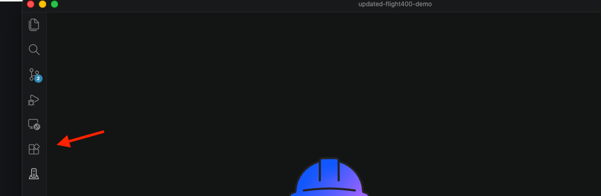
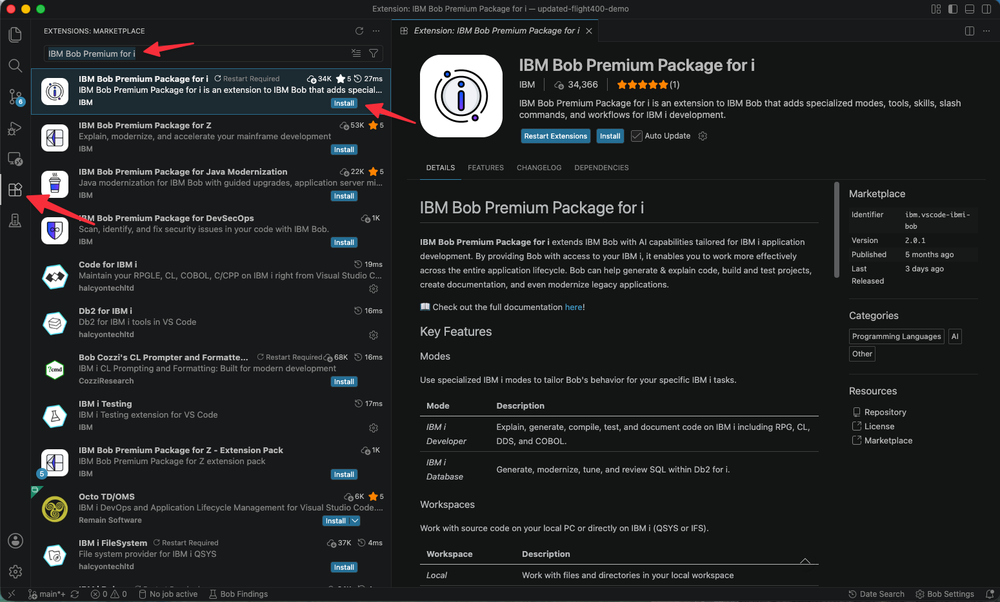
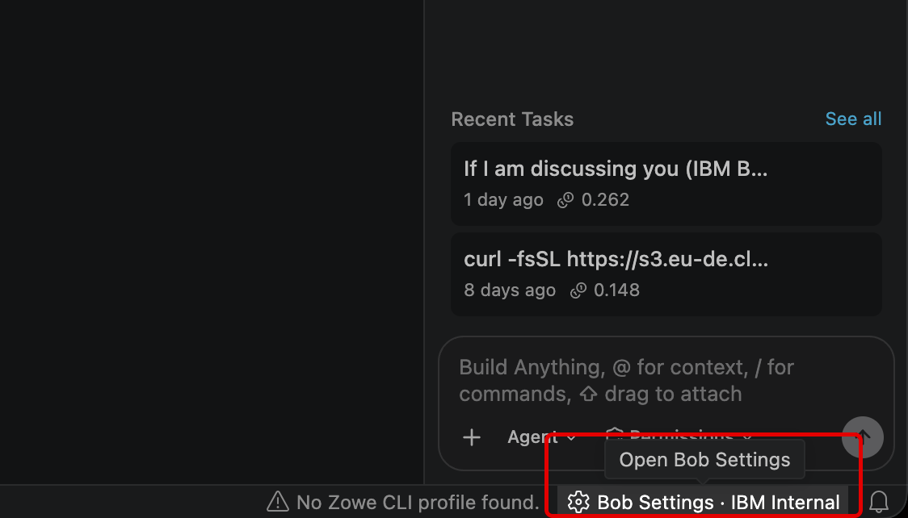
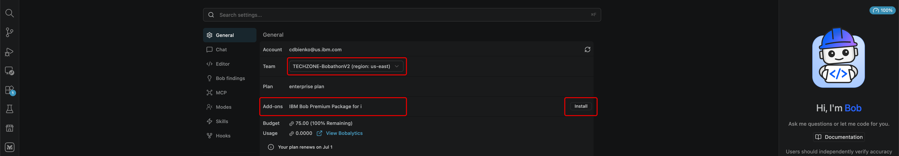
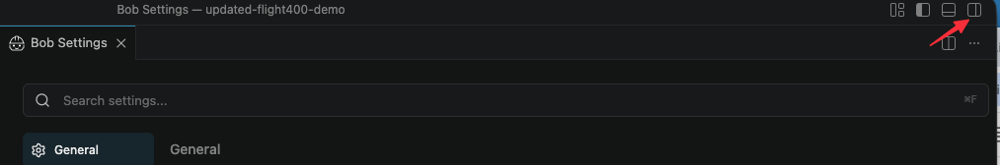
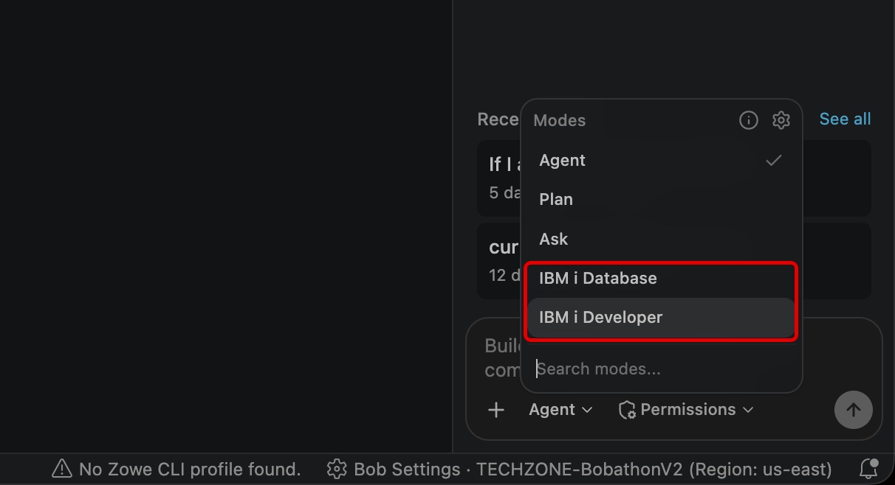
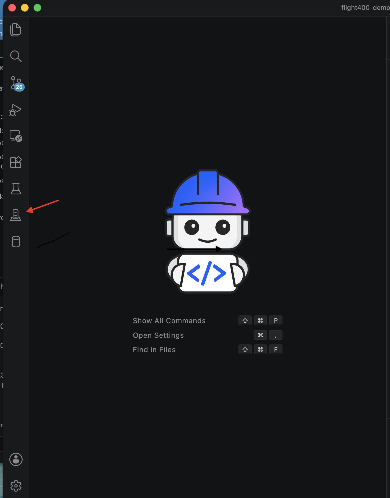
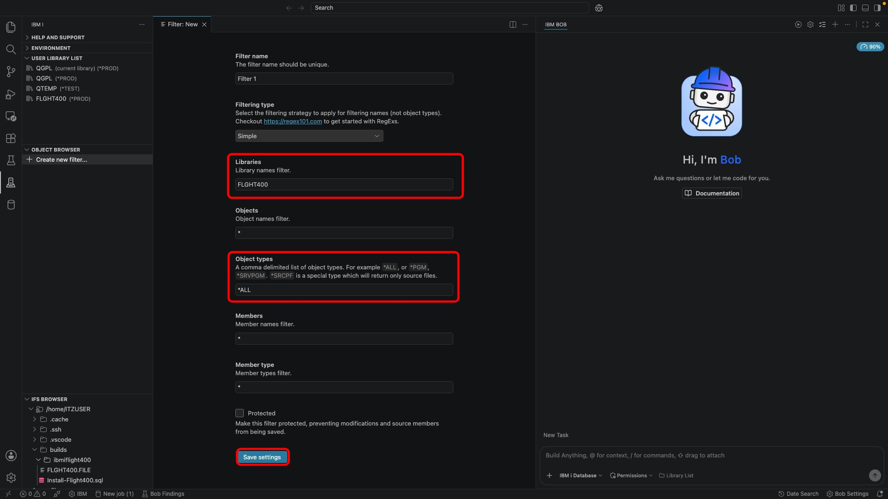

# Environment Setup

Complete all steps below before starting any exercise. Start by installing and logging in to Bob, then verify your extensions, find your library number, and finally connect to IBM i.

---

## 0.1 — Pre-Requisite Bob Setup

Check your inbox for the **"You've been invited to join your team"** email, then follow these steps to install Bob and sign in for the first time.

1. **Create your IBM ID** — Open the invitation email and click the link to create your IBM ID. This gives you an account to access IBM Bob.

2. **Download & open Bob** — Download Bob using the correct installer for your computer, then open it. If Bob asks whether to import settings from another editor, click your regular IDE or **Skip for now**. If it asks about chat migration, click **Skip migration**.

3. **Log in to Bob** — In the Bob chat window, click **Log in to Bob**. When asked to allow Bob to sign in, click **Allow**. Bob will then ask if you want to open a link — click **Open**. This opens your browser to complete the sign-in.

4. **Verify your account is active** — Click the **gear icon** above the Bob chat window. If the chat window isn't open, click the Bob icon to the right of the center search bar to open it first.

   

   Under the **General** tab, confirm that coins are listed in your budget at **100% remaining** — this means your account is active and ready.

   > 💡 **Team dropdown:** If you have used Bob before and belong to multiple teams, a team dropdown will appear — make sure it shows a team with **Bobathon** in the name. If you only belong to one team, the dropdown may not be visible at all, which is expected.

   

---

## 0.2 — Verify and Install Required Extensions

Two extensions are required. The **IBM Bob Premium Package for i** is often pre-installed for your team — verify it below. The **IBM i Development Pack** must be installed manually.

1. **Open the Extensions view** — Click the Extensions icon in the Activity Bar or press `Cmd+Shift+X` (macOS) / `Ctrl+Shift+X` (Windows/Linux).

   

2. **Verify IBM Bob Premium Package for i** — Search for `"IBM Bob Premium"`. If it appears with an **Install** button, click it. If there is no Install button, skip to step 3.

   

3. **Install IBM i Development Pack** — Search for `"IBM i Development Pack"`. This extension is **not** pre-installed — click **Install** if it does not appear under *Installed*. Reload Bob if prompted.

4. **Open Bob Settings** — Click the **Bob Settings** button in the bottom-right corner of the Bob IDE.

   

5. **Install Premium Package for i** — Under **Add ons**, find IBM Bob Premium Package for i and click **Install**. Restart Bob if prompted.

   

6. **Confirm it is activated** — Return to the Bob chat and click **Agent** or **+**. You should see **IBM i Developer** and **IBM i Database** modes listed.

   

   

---

## 0.3 — Find Your Assigned Library Number

Your instructor will assign you a library number. Each participant has their own copy of the FLIGHT400 application in a library named **FLGHT4nn** (e.g. FLGHT401, FLGHT402). **Use only your assigned number throughout all exercises.**

> 💡 **Spelling note:** The library name is `FLGHT4nn` — there is **no "I"** in FLGHT.

| Student # | Library | Dev Port | React App URL |
|:---------:|---------|:--------:|---------------|
| 1  | `FLGHT401` | 3001 | `http://localhost:3001` |
| 2  | `FLGHT402` | 3002 | `http://localhost:3002` |
| 3  | `FLGHT403` | 3003 | `http://localhost:3003` |
| 4  | `FLGHT404` | 3004 | `http://localhost:3004` |
| 5  | `FLGHT405` | 3005 | `http://localhost:3005` |
| 6  | `FLGHT406` | 3006 | `http://localhost:3006` |
| 7  | `FLGHT407` | 3007 | `http://localhost:3007` |
| 8  | `FLGHT408` | 3008 | `http://localhost:3008` |
| 9  | `FLGHT409` | 3009 | `http://localhost:3009` |
| 10 | `FLGHT410` | 3010 | `http://localhost:3010` |
| 11 | `FLGHT411` | 3011 | `http://localhost:3011` |
| 12 | `FLGHT412` | 3012 | `http://localhost:3012` |
| 13 | `FLGHT413` | 3013 | `http://localhost:3013` |
| 14 | `FLGHT414` | 3014 | `http://localhost:3014` |
| 15 | `FLGHT415` | 3015 | `http://localhost:3015` |
| 16 | `FLGHT416` | 3016 | `http://localhost:3016` |
| 17 | `FLGHT417` | 3017 | `http://localhost:3017` |
| 18 | `FLGHT418` | 3018 | `http://localhost:3018` |
| 19 | `FLGHT419` | 3019 | `http://localhost:3019` |
| 20 | `FLGHT420` | 3020 | `http://localhost:3020` |
| 21 | `FLGHT421` | 3021 | `http://localhost:3021` |
| 22 | `FLGHT422` | 3022 | `http://localhost:3022` |
| 23 | `FLGHT423` | 3023 | `http://localhost:3023` |
| 24 | `FLGHT424` | 3024 | `http://localhost:3024` |
| 25 | `FLGHT425` | 3025 | `http://localhost:3025` |
| 26 | `FLGHT426` | 3026 | `http://localhost:3026` |
| 27 | `FLGHT427` | 3027 | `http://localhost:3027` |
| 28 | `FLGHT428` | 3028 | `http://localhost:3028` |
| 29 | `FLGHT429` | 3029 | `http://localhost:3029` |
| 30 | `FLGHT430` | 3030 | `http://localhost:3030` |
| 31 | `FLGHT431` | 3031 | `http://localhost:3031` |
| 32 | `FLGHT432` | 3032 | `http://localhost:3032` |
| 33 | `FLGHT433` | 3033 | `http://localhost:3033` |
| 34 | `FLGHT434` | 3034 | `http://localhost:3034` |
| 35 | `FLGHT435` | 3035 | `http://localhost:3035` |
| 36 | `FLGHT436` | 3036 | `http://localhost:3036` |
| 37 | `FLGHT437` | 3037 | `http://localhost:3037` |
| 38 | `FLGHT438` | 3038 | `http://localhost:3038` |
| 39 | `FLGHT439` | 3039 | `http://localhost:3039` |
| 40 | `FLGHT440` | 3040 | `http://localhost:3040` |
| 41 | `FLGHT441` | 3041 | `http://localhost:3041` |
| 42 | `FLGHT442` | 3042 | `http://localhost:3042` |
| 43 | `FLGHT443` | 3043 | `http://localhost:3043` |
| 44 | `FLGHT444` | 3044 | `http://localhost:3044` |
| 45 | `FLGHT445` | 3045 | `http://localhost:3045` |
| 46 | `FLGHT446` | 3046 | `http://localhost:3046` |
| 47 | `FLGHT447` | 3047 | `http://localhost:3047` |
| 48 | `FLGHT448` | 3048 | `http://localhost:3048` |
| 49 | `FLGHT449` | 3049 | `http://localhost:3049` |
| 50 | `FLGHT450` | 3050 | `http://localhost:3050` |

> 💡 The **Dev Port** is only needed for **Exercise 4**. Your React app will be reachable at the React App URL shown — provided your SSH tunnel (0.5) is active.

---

## 0.4 — Connect Bob IDE to IBM i

1. **Add a new connection** — Click the IBM i icon in the Activity Bar, then click **New Connection**. Enter the host IP, user profile, and `ssh_private_key.pem` provided by your instructor. **Do not use the password here — use only the private key file.**

   

   

   > 💡 If you get a private key error, see step 1 of 0.5 for instructions on setting the correct file permissions.

2. **Add your library to the User Library List** — In the Code for IBM i extension, go to **User Library List** and click **+**. Type `FLGHT4nn` and press **Enter**.

   

   

3. **Add your library to the Object Browser** — Go to **Object Browser** and click the funnel icon or **Create new filter**. Set **Libraries** to `FLGHT4nn` and **Object types** to `*ALL`. Click **Save Settings**.

   > ⚠️ Use `*ALL`, not `*` — the wildcard `*` does not work here.

   

4. **Set the workspace to Library List** — Click **+** above the Bob chat window and select **New Task in Library List**, confirming your `FLGHT4nn` library is listed.

   

---

## 0.5 — SSH Tunnel (for Green Screen and Exercise 4)

1. **Set private key permissions** — After downloading `ssh_private_key.pem` from the Box folder:

   **macOS / Linux:**
   ```bash
   chmod 600 ssh_private_key.pem
   ```

   **Windows (PowerShell):**
   ```powershell
   icacls ssh_private_key.pem /inheritance:r /grant:r "$($env:USERNAME):R"
   ```

2. **Open the SSH tunnel** — Replace `<myuser>@<myIPaddress>` with the values from your instructor. Run from the folder containing `ssh_private_key.pem`.

   

   ```bash
   ssh -L 50000:localhost:23 -L 2001:localhost:2001 -L 449:localhost:449 -L 8470:localhost:8470 -L 8471:localhost:8471 -L 8472:localhost:8472 -L 2007:localhost:2007 -L 8473:localhost:8473 -L 8474:localhost:8474 -L 8475:localhost:8475 -L 8476:localhost:8476 -L 2003:localhost:2003 -L 2002:localhost:2002 -L 2006:localhost:2006 -L 2300:localhost:2300 -L 2323:localhost:2323 -L 2005:localhost:2005 -L 8076:localhost:8076 -L 3001:localhost:3001 -L 3002:localhost:3002 -L 3003:localhost:3003 -L 3004:localhost:3004 -L 3005:localhost:3005 -L 3006:localhost:3006 -L 3007:localhost:3007 -L 3008:localhost:3008 -L 3009:localhost:3009 -L 3010:localhost:3010 -L 3011:localhost:3011 -L 3012:localhost:3012 -L 3013:localhost:3013 -L 3014:localhost:3014 -L 3015:localhost:3015 -L 3016:localhost:3016 -L 3017:localhost:3017 -L 3018:localhost:3018 -L 3019:localhost:3019 -L 3020:localhost:3020 -L 3021:localhost:3021 -L 3022:localhost:3022 -L 3023:localhost:3023 -L 3024:localhost:3024 -L 3025:localhost:3025 -L 3026:localhost:3026 -L 3027:localhost:3027 -L 3028:localhost:3028 -L 3029:localhost:3029 -L 3030:localhost:3030 -L 3031:localhost:3031 -L 3032:localhost:3032 -L 3033:localhost:3033 -L 3034:localhost:3034 -L 3035:localhost:3035 -L 3036:localhost:3036 -L 3037:localhost:3037 -L 3038:localhost:3038 -L 3039:localhost:3039 -L 3040:localhost:3040 -L 3041:localhost:3041 -L 3042:localhost:3042 -L 3043:localhost:3043 -L 3044:localhost:3044 -L 3045:localhost:3045 -L 3046:localhost:3046 -L 3047:localhost:3047 -L 3048:localhost:3048 -L 3049:localhost:3049 -L 3050:localhost:3050 -o ExitOnForwardFailure=yes -o ServerAliveInterval=15 -o ServerAliveCountMax=3 <myuser>@<myIPaddress> -i ssh_private_key.pem
   ```

3. **(Optional) Connect IBM i Access Client Solutions for 5250** — Only needed if you want to view the green screen. Install [IBM i Access Client Solutions](https://www.ibm.com/support/pages/ibm-i-access-client-solutions), make sure the SSH tunnel is running, then open the 5250 Emulator with IP `127.0.0.1` and port `50000`.

   ```
   ADDLIBLE FLGHT4nn
   CALL FLGHT4nn/FRS021
   ```

   

   > ⚠️ Exit the 5250 screen with **F3** when finished.
